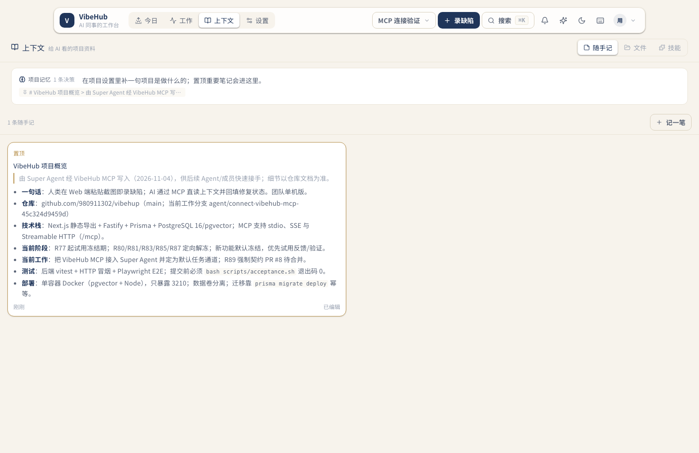
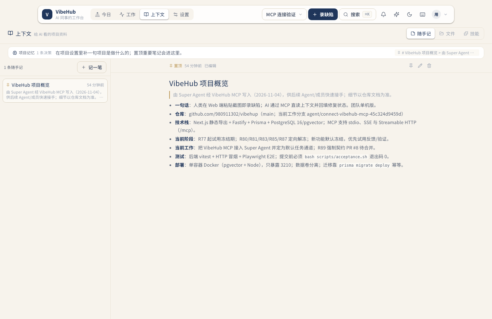
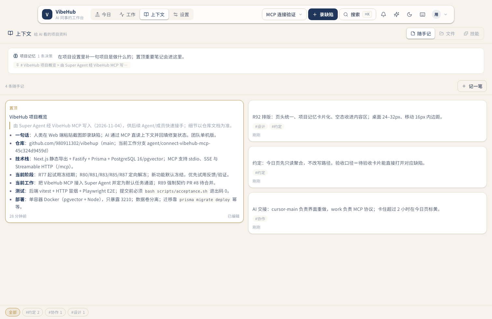
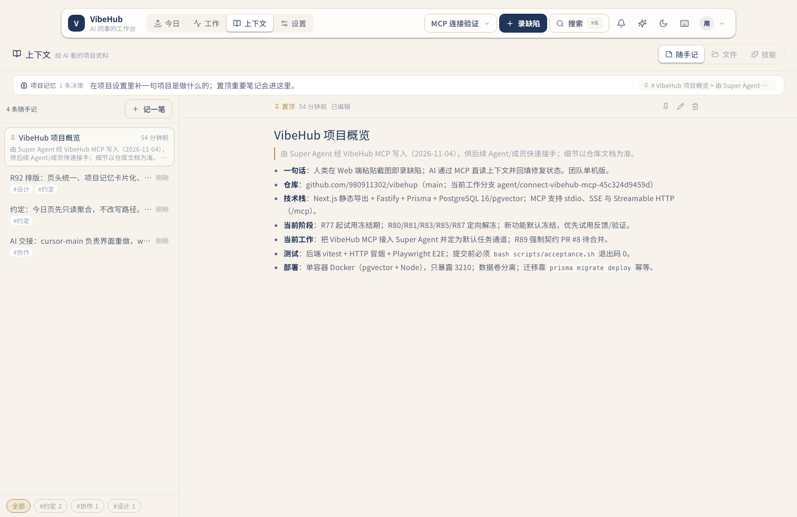

# R93 上下文 · 随手记：布局与信息密度

## 问题（用户反馈）

「上下文」页把内容摊开后不好用，一屏显示的内容也少。原布局是：页头 + 全宽项目记忆卡 + 全宽工具条 + 两列瀑布流；在 1512px 桌面上，只有一条笔记时，笔记卡宽 733px、右半屏空白；长笔记把其他笔记全部挤出首屏。940px 窄桌面与手机上，工具条和记忆卡先占掉约 240px，正文更少。

## 改动

- **桌面 ≥900px：索引 + 全文双栏。** 左栏 340px 固定宽度，逐条显示标题、两行纯文本预览、时间与标签，一屏可扫多条；右栏是完整 Markdown 阅读/编辑区，独立滚动，正文限宽 860px。
- **<900px：先列表、点开全文。** 列表页保留标题和预览；点一条进入全文，左上角返回键回列表，不再把长笔记直接摊在首屏。
- **项目记忆收成一行。** 高度 80px → 38px，项目一句话与置顶决策 chip 同行排列，不再占据一整条色带。
- **工具条并入索引头。** 计数、「记一笔」和标签筛选都收进左栏，不再单独占一条全宽工具条；内容起点从 y=308 提前到 y=181。
- **全文排版分级。** 详情里的 h1/h2/h3 放大到 22/17/15px，正文仍 14px/1.7；列表摘要由纯函数 `web/src/lib/note-summary.ts` 提取，不改 API、不改数据结构。

## 证据

同一账号、同一项目、同一主题（Daylight，另附暗色），同一组数据前后对比；截图均为真实运行页面。

| 场景 | 改前 | 改后 |
| --- | --- | --- |
| 1512×982，1 条长笔记 |  |  |
| 940×611，1 条长笔记 |  |  |
| 1512×982，4 条笔记（密度） |  |  |

补充：

- 暗色：
- 390px 列表：
- 390px 全文：

## 验证

- `cd web && npx tsc --noEmit`
- `cd server && npx vitest run --root ../web`（含新增 `note-summary` 4 条）
- `bash server/scripts/acceptance.sh`（tsc + vitest + HTTP 冒烟 + Playwright E2E）
- Playwright 实机走通：桌面切换笔记、编辑保存、标签筛选、新建后自动选中、删除；390px 列表→全文→返回、录入器打开；无 console/page error。
