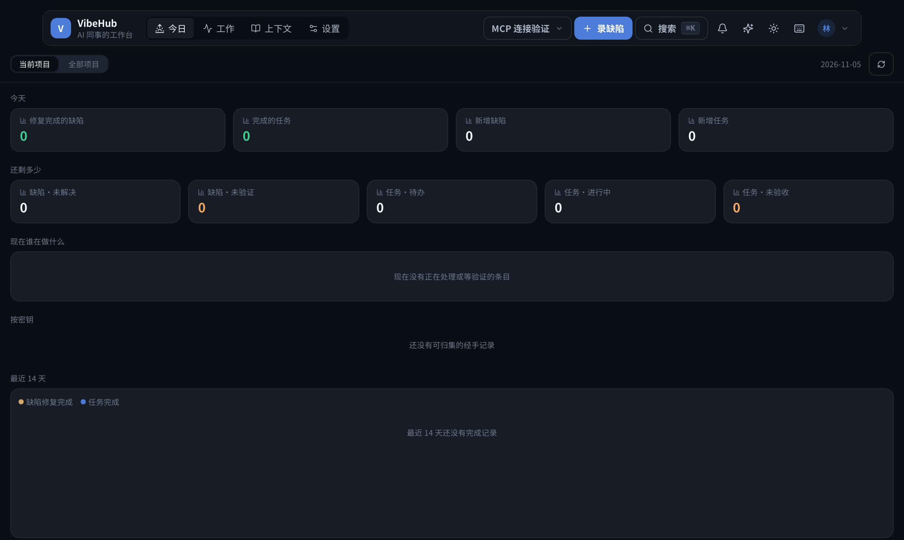
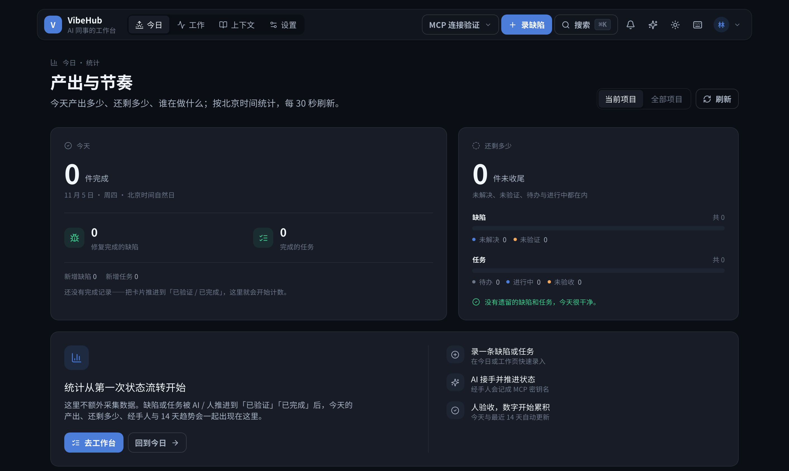
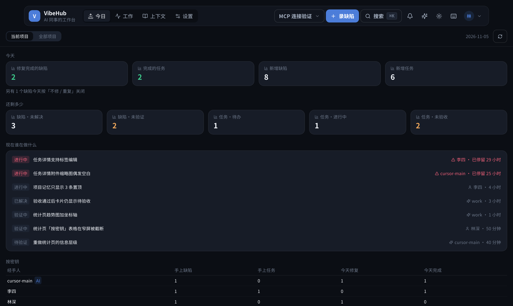
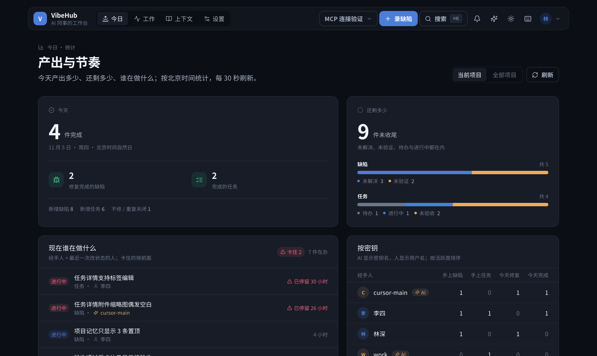
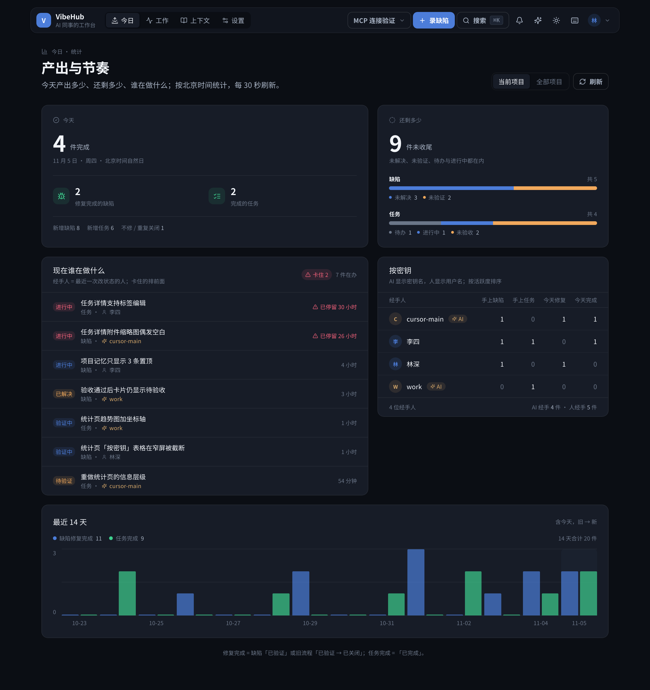
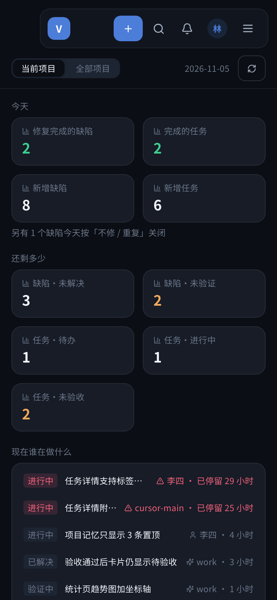
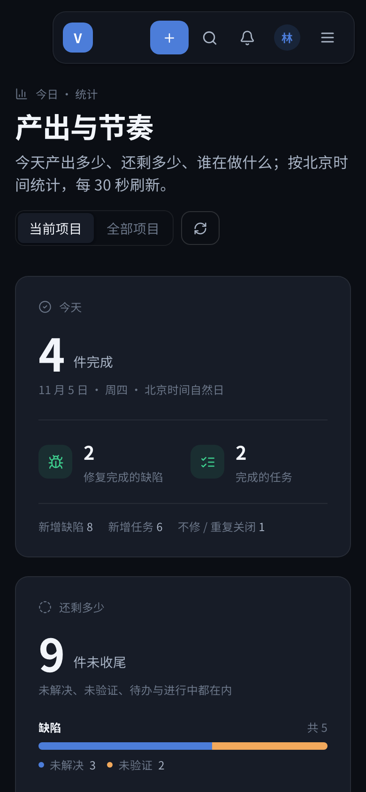
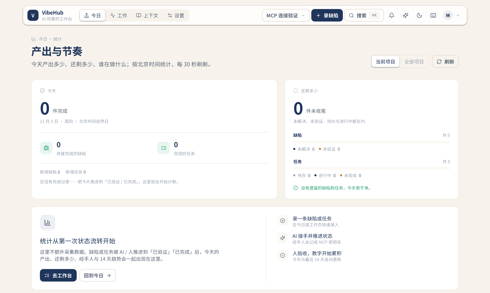
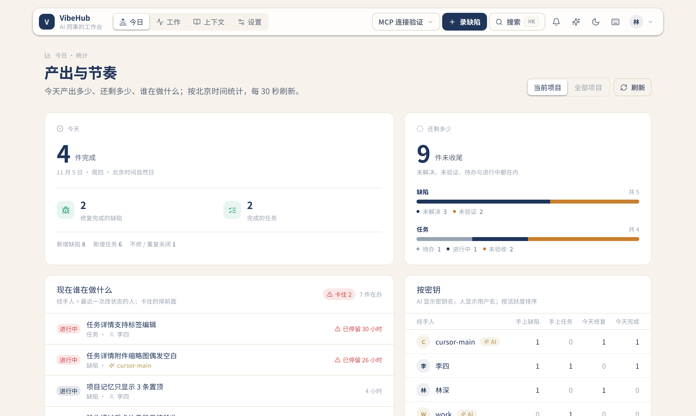
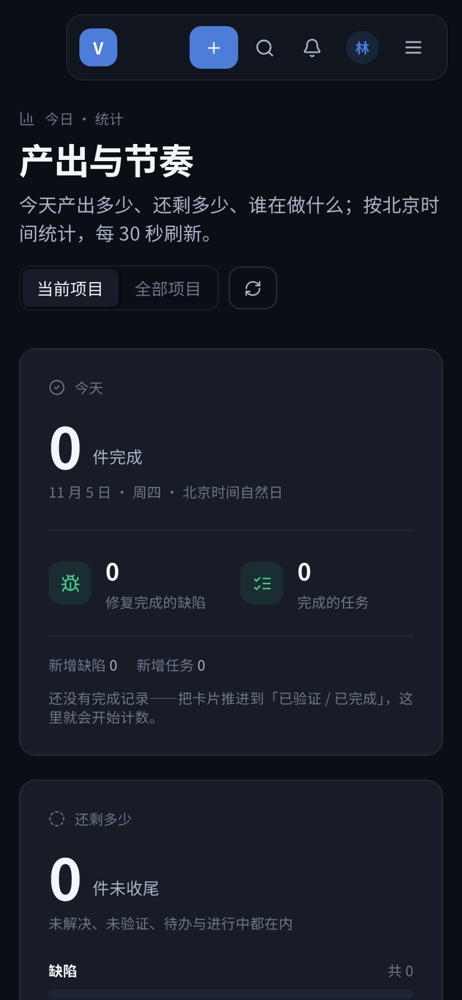

# R94 统计页 · 界面重做

## 问题（用户反馈）

2026-11-05，用户发来 `/stats` 截图（当前项目「MCP 连接验证」，全 0，1412×844，Midnight）并说「这个界面设计不行」。

原页面把五段内容从上到下平铺：

- 页头只有一个范围切换，没有标题与说明；两排 4/5 个小卡片，12px 灰字标签叠小数字；
- 全 0 时是四块空盒子加一行居中提示，「现在谁在做什么」「按密钥」各占一大块，首屏信息密度低；
- 「按密钥」是裸表格，趋势图没有坐标、刻度和日期，只有 hover 才出现日期标签；
- 非 AI 的缺陷系列用了金色，与「金色只标识 AI」的视觉约定冲突；
- 没有使用 R89 的 `vh-page` / `vh-card` / `t-*` 命名样式，与今日、工作、上下文页不像同一套产品。

## 改法

- **页头**：`今日 · 统计` / `产出与节奏` + 一句口径说明；范围切换改成 `vh-segmented`，刷新按钮带文字与旋转反馈。
- **今天 / 还剩多少两张主卡**：主数字 48px；今天拆「修复完成的缺陷 / 完成的任务」两项并补新增与不修数；还剩多少用缺陷、任务两组堆叠条 + 图例，零值也保留结构。
- **全空数据不再铺空盒子**：四块空卡片改为一段「统计从第一次状态流转开始」引导，三步说明「录单 → AI 推进 → 人验收」，并给出工作台 / 今日入口；空项目内容高度 844，首屏能完整看到引导卡。
- **现在谁在做什么**：卡头显示在办数与「卡住 N」；每行状态色 + 标题 + 类型/经手人（AI 金色 + 密钥名）+ 停留时长，卡住的用危险色并排前。
- **按密钥**：卡片化表格，头像 + AI 徽章 + 活跃度排序 + 底部 AI/人经手合计；≥640px 用表格，390px 改成每人一行的四格数值，避免横向截断。
- **最近 14 天**：补图例、14 天合计、0/中/顶网格、日期刻度与今天高亮；系列色改为品牌蓝 + 成功绿，金色只留给 AI。
- **只动展示层**：不改 `GET /api/stats`、不改数据结构与写路径；新增的只是 `stats-view` 纯函数与对应单测。

## 证据

基线 `origin/main@d3b8a93`；改后为本 PR 分支头。同一账号、同一主题、同一组数据；空项目与有数据项目分别截图。数据为本地临时库夹具（18 个缺陷 / 14 个任务），截图后已丢弃，未进入任何提交。

### 1412×844，空项目（用户报告场景，暗色）

| 改前 | 改后 |
| --- | --- |
|  |  |

### 1412×844，有数据（同一项目、同一主题）

| 改前 | 改后 |
| --- | --- |
|  |  |

完整内容（1412×1500）：

### 390×844，有数据（移动端）

| 改前 | 改后 |
| --- | --- |
|  |  |

### 补充

- 纸白 · 空项目：
- 纸白 · 有数据：
- 390px · 空项目：

## 验证

- `cd web && npx tsc --noEmit` → 0 错误
- `cd server && npx vitest run --root ../web` → **54 passed**（新增 totals / 分组 / 日期 7 条）
- `cd web && npx next build` → 0 错误（`/stats` 10.6 kB）
- `bash server/scripts/acceptance.sh` → **PASS=19 FAIL=0**（vitest **370 passed**、E2E **14 passed**、HTTP 冒烟、日志脱敏）
- Playwright 实测：1412×844 与 390×844、Midnight + Daylight、空项目 + 有数据；无横向溢出（`docOverflowX/mainOverflowX = 0`）、无 console/page error；空项目首屏内容高 844，两张主卡等高，引导卡完整可见。
