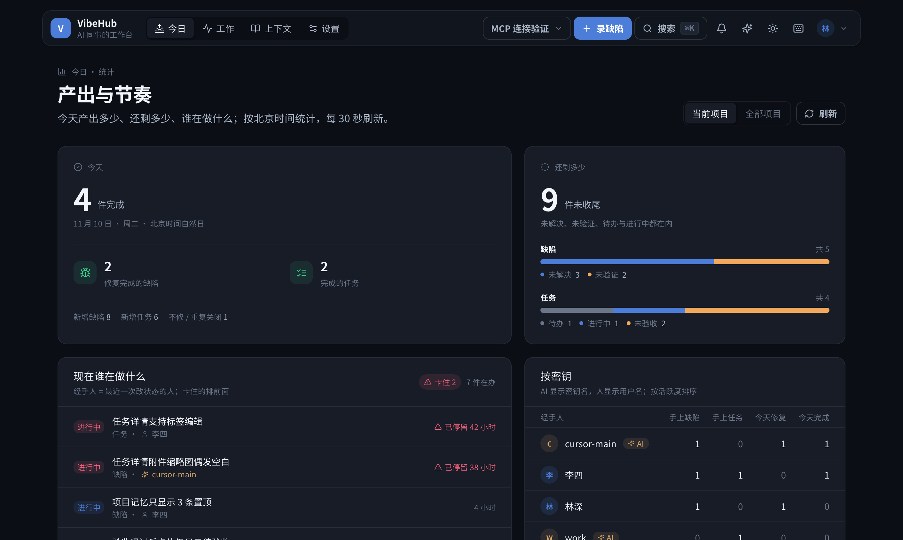
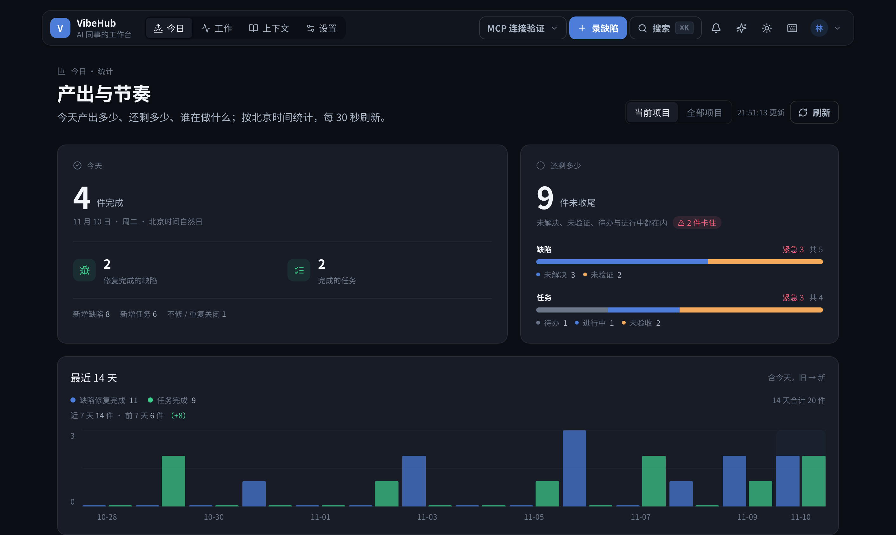
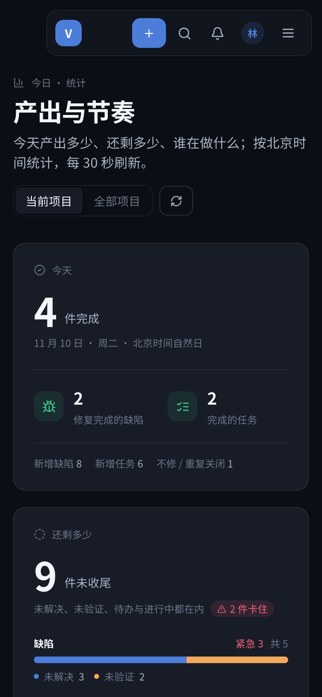
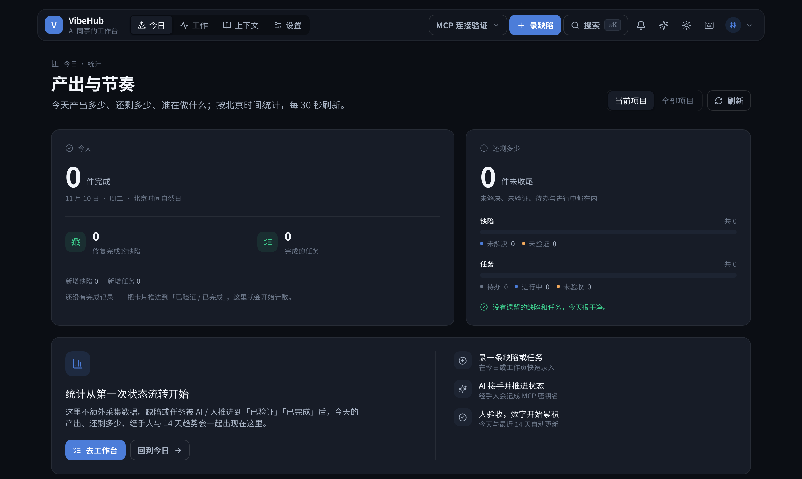
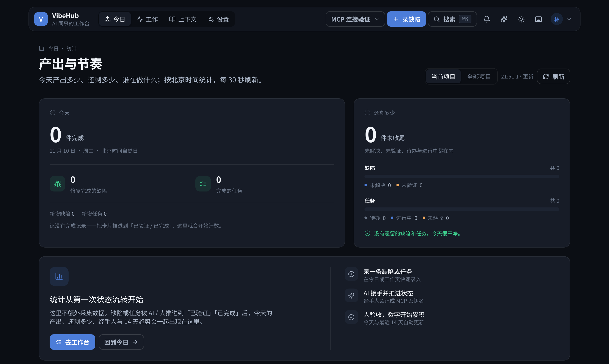
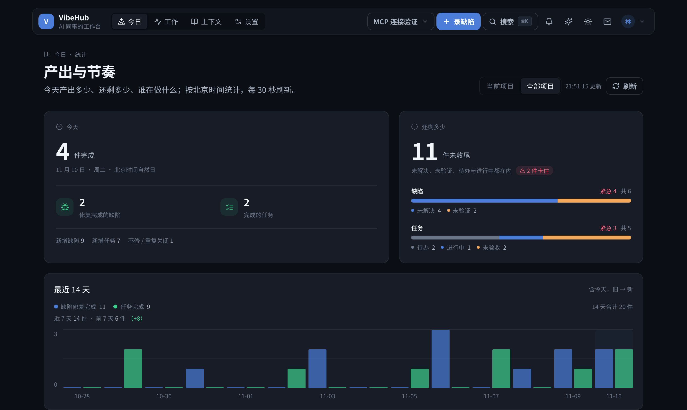
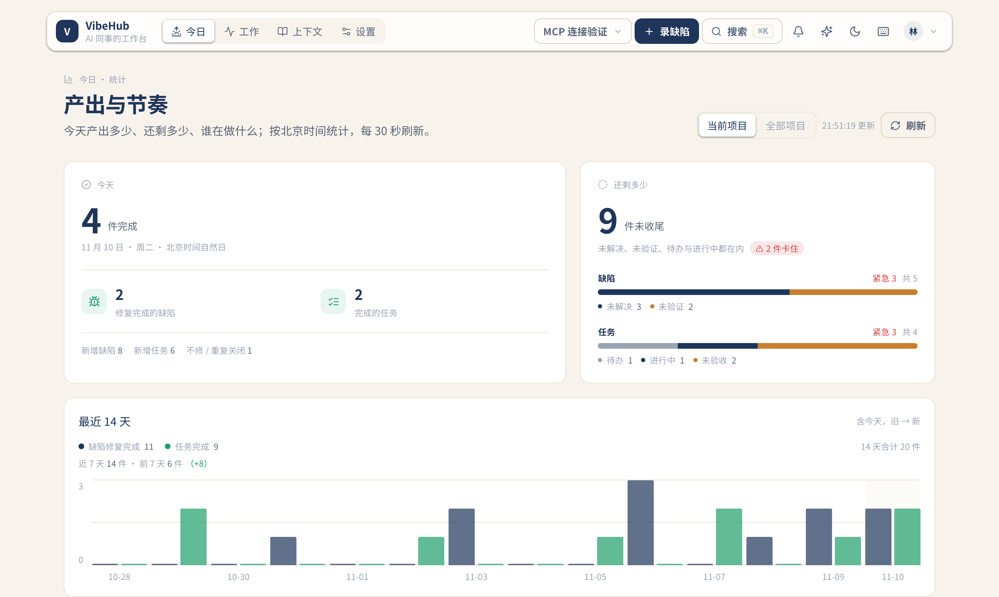

# R95 统计页 · 第二轮优化

## 问题（用户反馈）

R94 重做后用户问「还有什么可以优化的没？」，确认要优化。对照 1412×844 的实机页面，还有四个具体问题：

- **14 天趋势要滚动才看到**：趋势卡在 y=1097，而首屏只到 844；先看到的是在办列表，趋势被压到第二屏。
- **没有「最后更新」时间**：页面每 30 秒自动刷新，但看不出来数据是什么时候的。
- **剩余工作只有数量**：不知道其中有多少紧急、有多少卡住；「还剩多少」的总数没有风险信号。
- **「全部项目」下在办项没有项目名**：跨项目时一行只有标题和经手人，无法判断属于哪个项目。

## 改法

- **趋势上首屏**：把「最近 14 天」卡移到在办列表之前；1412×844 下趋势卡从 y=1097 提前到 y=562，卡底正好 844，首屏完整可见。趋势卡内边距与绘图区高度同步收紧（p-5、120px）。
- **近 7 天 / 前 7 天对比**：图例下方显示两段完成量与差值（+/-），不用自己心算。
- **最后更新时间**：页头刷新按钮旁显示 `HH:mm:ss 更新`（北京时间），每次成功加载后更新；移动端隐藏以省空间。
- **剩余工作加风险**：`GET /api/stats` 的 `remaining.bugs/tasks` 新增 `urgent`（剩余缺陷 severity critical/high、剩余任务 priority high，只数仍未收尾的），卡片分组头显示「紧急 N」；当前在办里卡住的数量进入摘要「N 件卡住」。
- **在办项补项目名**：切到「全部项目」时，在办行显示「项目名 · 缺陷/任务 · 经手人」；当前项目范围不重复显示。
- **只动展示层 + 一个只读聚合字段**：不改状态机、写路径、权限或数据模型；`urgent` 是 `services/stats.ts` 内存聚合的增量字段，向后兼容。

**本轮未做**：剩余数字/按密钥行的下钻筛选。现有看板/任务页没有按状态、按经手人的 URL 筛选，补这个要同时改看板、任务页与读模型，单独排更稳。

## 证据

基线 `origin/main@d13ece3`（R94 已上线版本）；改后为本 PR 分支头。同一账号、同一组本地夹具数据（18 缺陷 / 14 任务）、同一主题与视口；基线由 d13ece3 工作树构建，改后为当前分支构建。

### 1412×844，有数据（暗色）

| 改前 | 改后 |
| --- | --- |
|  |  |

### 390×844，有数据

| 改前 | 改后 |
| --- | --- |
|  |  |

### 1412×844，空项目

| 改前 | 改后 |
| --- | --- |
|  |  |

### 补充

- 全部项目（在办行带项目名）：
- 纸白主题：

## 验证

- `bash server/scripts/acceptance.sh` → **PASS=19 FAIL=0**（vitest **371 passed**、E2E 14、HTTP 冒烟、日志脱敏）
- `cd server && npx vitest run --root ../web` → **56 passed**（新增 7 天窗口与刷新时间用例）
- 双端 `tsc --noEmit` 0 错误；`next build` 0 错误
- Playwright 实测：1412×844 暗色/纸白、390×844、空项目/有数据/全部项目；无横向溢出、无 console/page error；趋势卡底 = 844，在办列表从 y=864 开始；紧急、卡住、更新时间、项目名与 7 天对比均按预期出现。
