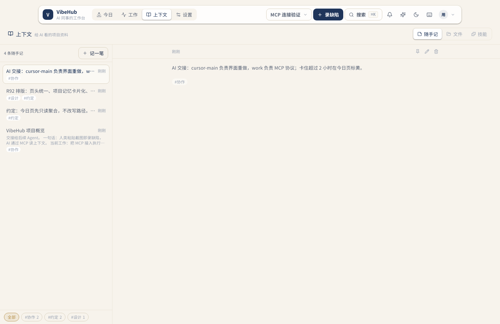
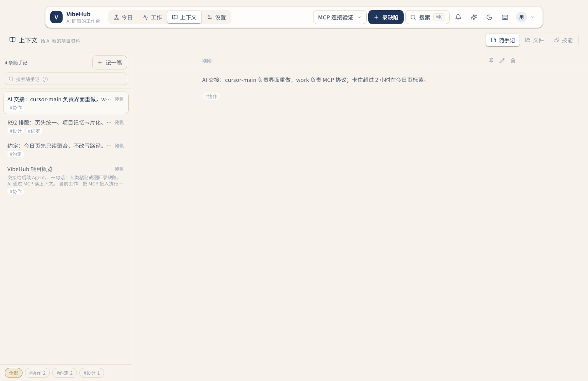
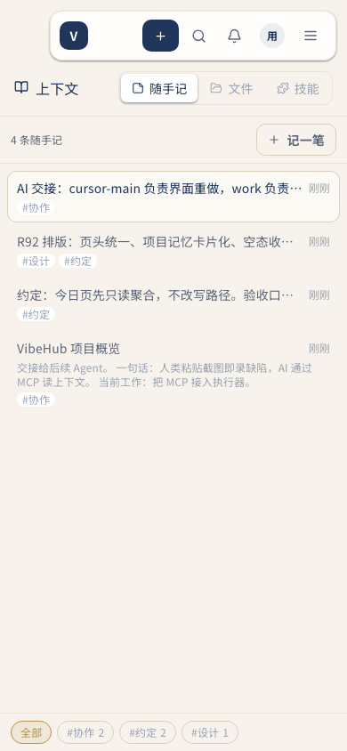
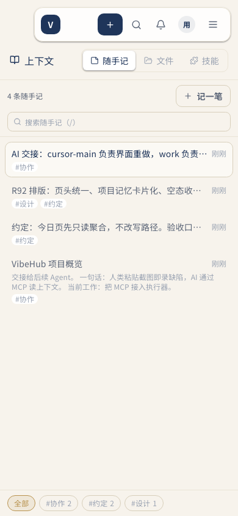
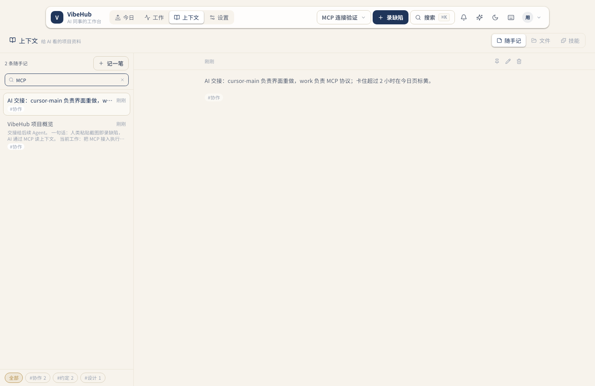
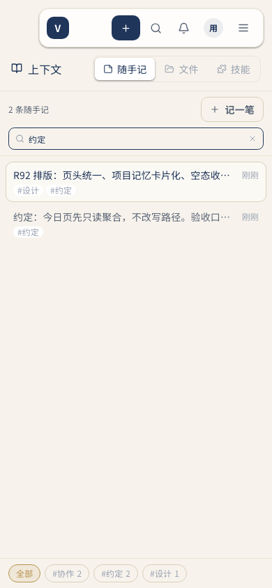

# R95 随手记搜索（R93 后的下一步优化）

## 问题

上下文页改成「索引 + 全文」后，索引已经能一屏扫多条；但笔记继续增长时，只能靠标题/预览逐条找。用户要求继续优化，先补最直接的检索能力。

## 改动

- 索引顶部新增搜索框，匹配**正文与标签**（忽略大小写与首尾空白），与现有标签筛选可叠加。
- `/` 聚焦搜索；输入框内 `Esc` 清空并退出；有内容时显示 `×` 一键清空。
- 搜索无结果时给明确空态与「清空搜索」按钮，而不是只显示空列表。
- 新建随手记会自动清空搜索与标签筛选，保证刚写的笔记可见。
- 纯前端过滤，不改 API、数据模型和 MCP。

## 证据

同一项目、同一组 4 条笔记、Daylight 主题；1512×982 与 390×844。

| 场景 | 改前 | 改后 |
| --- | --- | --- |
| 1512，默认索引 |  |  |
| 390，默认索引 |  |  |

搜索生效：

- 1512 输入「MCP」后剩 2 条，右侧自动显示匹配笔记：
- 390 输入「约定」后剩 2 条：

## 验证

- `cd web && npx tsc --noEmit`
- `cd server && npx vitest run --root ../web`（新增 `noteMatchesQuery` 用例）
- `bash server/scripts/acceptance.sh`
- Playwright 实机：`/` 聚焦、输入过滤、计数从 4→2、清空恢复 4、无结果空态、移动端过滤后进入全文；无 console/page error。
